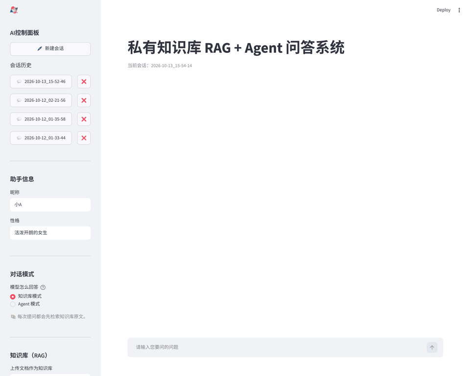
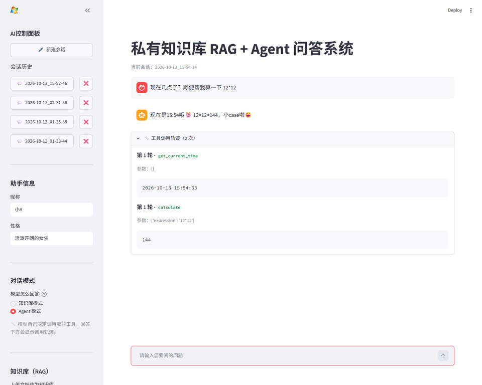

# 私有知识库 RAG + Agent 问答系统

一个基于 **Streamlit + DeepSeek** 的问答系统，包含两个子系统：

- **RAG 检索链路** —— 文档知识库、语义向量检索、rerank 精排、答案可溯源
- **Agent 工具调度链路** —— 由模型自主决定是否调用工具（知识库检索 / 数学计算 / 当前时间查询）

## ✨ 功能特性

- 多会话流式对话（支持自定义昵称与人格设定）
- 上传文档（txt / md / pdf / docx）构建私有知识库
- 语义向量检索（BGE 中文 embedding + 余弦相似度）
- Rerank 重排（bge-reranker 精排，提升检索精度）
- 答案可溯源（回答下方展示命中的知识库片段）
- 多轮对话记忆（历史发言向量化，检索相关记忆融入回答）
- **Agent 工具调用** —— 模型自主决定调不调工具、调哪个，支持一次提问并行调用多个工具
- **工具调用轨迹可见** —— 界面可折叠面板 + JSONL 结构化落盘，决策链路全程可复盘
- **双对话模式** —— 侧边栏可切换「知识库模式」（每问必检索）与「Agent 模式」（按需调用）
- **HTTP 接口服务** —— 以 FastAPI 暴露 `POST /chat`、`POST /knowledge` 等接口，同一套调度逻辑可供任意前端调用
- **多客户端隔离与知识库持久化** —— 请求头 `X-Client-Id` 区分各自的知识库，数据落盘后服务重启自动恢复
- **向量存储可切换** —— 一套接口两种后端：Chroma（HNSW 近似最近邻 + 持久化）/ NumPy（全量扫描，零依赖降级），换后端不动调用方代码
- **容器化运行** —— 两阶段构建、非 root 运行、`/health` 就绪探针、`docker compose` 一条命令拉起 API 与界面；镜像 5.4GB，已在本地完整实测（见「实测结果」）

## 🎬 效果演示



上图为真实运行过程：切到「Agent 模式」后提问，模型自行判断需要工具，先后调用 `get_current_time` 与 `calculate`，回答下方同步给出可展开的工具调用轨迹。

下面再用终端记录展示接口层的完整行为，输出原样粘贴。

**① 上传一份资料（以 alice 的身份）**

```bash
curl -X POST http://127.0.0.1:8000/knowledge \
  -H "Content-Type: application/json" \
  -H "X-Client-Id: alice" \
  -d '{"source": "员工手册.md", "content": "公司实行弹性工作制，核心工作时间为上午 10 点到下午 4 点。员工每年享有 5 天全薪病假。试用期为 3 个月，试用期内提前 3 天申请即可离职。"}'
```

```json
{"sources": ["员工手册.md"], "chunks": 1}
```

**② 提问——模型自行判断需要检索，并一次拆成两个子查询**

```bash
curl -X POST http://127.0.0.1:8000/chat \
  -H "Content-Type: application/json" \
  -H "X-Client-Id: alice" \
  -d '{"question": "试用期多久？核心工作时间是什么时候？"}'
```

```json
{
  "answer": "根据知识库中的资料：\n\n- **试用期**：3 个月。试用期内提前 3 天申请即可离职。\n- **核心工作时间**：上午 10 点到下午 4 点（公司实行弹性工作制）。",
  "trace": [
    {
      "round": 1,
      "tool": "search_knowledge",
      "args": { "query": "试用期多久" },
      "result": "【片段 1】\n公司实行弹性工作制，核心工作时间为上午 10 点到下午 4 点。员工每年享有 5 天全薪病假。试用期为 3 个月，试用期内提前 3 天申请即可离职。"
    },
    {
      "round": 1,
      "tool": "search_knowledge",
      "args": { "query": "核心工作时间" },
      "result": "【片段 1】\n公司实行弹性工作制，核心工作时间为上午 10 点到下午 4 点。员工每年享有 5 天全薪病假。试用期为 3 个月，试用期内提前 3 天申请即可离职。"
    }
  ]
}
```

**③ 换个客户端，看不到 alice 的资料（隔离生效）**

```bash
curl http://127.0.0.1:8000/knowledge -H "X-Client-Id: bob"
```

```json
{"sources": [], "chunks": 0}
```

**④ 重启服务后，alice 的资料依然在，且无需重新上传即可直接提问（持久化生效）**

```bash
# 重启 uvicorn 之后
curl http://127.0.0.1:8000/knowledge -H "X-Client-Id: alice"
```

```json
{"sources": ["员工手册.md"], "chunks": 1}
```

> Web 界面下，每次工具调用会以可折叠面板的形式显示在回答下方（`🔧 工具调用轨迹（N 次）`），面板内含轮次、工具名、参数与返回原文，与上面 `trace` 字段一一对应。

## 🧠 核心流程

### ① RAG 检索链路（知识库模式）

```
上传文档 → 解析 → 切块 → 向量化 → 存入知识库
提问 → 向量化 → 相似度检索 → rerank 精排 → 挑出最相关片段
片段注入提示词 → DeepSeek 生成回答 → 流式显示 + 展示引用来源
```

### ② Agent 工具调度链路（Agent 模式）

```
下发工具声明 → 模型判断是否需要工具
  ├─ 不需要 → 直接生成回答（不检索、不调工具）
  └─ 需要   → 模型返回结构化调用请求
              → 本地代码执行工具
              → 结果回填上下文 → 再交给模型
              → 循环，直到模型给出最终答复
```

> **关键点：执行工具的始终是本地 Python 代码，模型只输出"调用请求"文本。**
> 单轮最多允许 5 次循环（`MAX_ROUNDS` 护栏），防止模型不收敛导致请求失控。

## 🔧 Agent 工具清单

| 工具               | 作用                         | 说明                                  |
|--------------------|------------------------------|---------------------------------------|
| `search_knowledge` | 检索私有知识库的相关原文片段 | 复用 RAG 检索链路，返回原文而非答案   |
| `calculate`        | 四则运算计算                 | 正则白名单 + 剥离内置函数，防代码注入 |
| `get_current_time` | 获取当前日期与时间           | 模型无法凭记忆回答"今天几号"          |

**工具的两张表**（职责分离）：

- `TOOL_SCHEMAS` —— **声明表**，给模型看。只描述工具用途，模型据此判断该不该调、调哪个。
- `TOOLS` —— **注册表**，给代码用。工具名 → 真实函数的映射。

工具名、Python 参数名、Schema 键名三处强制保持一致。

## 🛡 安全设计

`calculate` 若直接对模型生成的表达式求值，模型可能被诱导产出读写文件、执行系统命令的恶意载荷。采用三级防护：

1. **正则整串白名单** —— `re.fullmatch(r"[0-9+\-*/().\s]+", expr)`，只放行数字与 `+ - * / ( )`
2. **剥离全部内置函数** —— `eval(expr, {"__builtins__": {}}, {})`
3. **异常兜底** —— 捕获异常并返回可读错误字符串，不中断主循环

实测可拦截 `__import__("os").system(...)` 类注入载荷。

## 📈 可观测性



每次工具调用都会结构化为一行 JSON 追加写入 `agent_trace.jsonl`（轮次 / 工具名 / 参数 / 结果），并在界面回答下方的可折叠面板中实时展示（见上图）。

```jsonl
{"time": "2026-10-12 00:39:09", "question": "现在几点了？顺便帮我算一下 (1234+5678)*3 等于多少。", "round": 1, "tool": "get_current_time", "args": {}, "result": "2026-10-12 00:39:08"}
{"time": "2026-10-12 00:39:09", "question": "现在几点了？顺便帮我算一下 (1234+5678)*3 等于多少。", "round": 1, "tool": "calculate", "args": {"expression": "(1234+5678)*3"}, "result": "20736"}
```

选 JSONL 是因为它是**追加式**格式：可以逐行 append，无需把整个文件读进内存重写。

## 🛠 技术栈

| 层           | 技术                          |
|--------------|-------------------------------|
| 界面         | Streamlit                     |
| 大模型       | DeepSeek API（OpenAI SDK）    |
| 工具调用     | DeepSeek Function Calling     |
| Embedding    | BAAI/bge-small-zh-v1.5        |
| Rerank       | BAAI/bge-reranker-base        |
| 相似度       | numpy（余弦相似度）/ Chroma（HNSW） |
| 轨迹落盘     | JSONL（追加式结构化日志）     |
| 接口服务     | FastAPI + Uvicorn             |
| 知识库持久化 | Chroma 向量库 / numpy 向量落盘（.npy + JSON） |
| 部署         | Docker 多阶段构建 + docker compose |

## 📊 评测结果

自建 10 题测试集，检索命中率（Top3）：

| 检索方法      | 命中率   |
|---------------|----------|
| 关键词检索    | 80%      |
| 向量检索      | **100%** |
| 向量 + rerank | **100%** |

## 🚀 安装与运行

```bash
# 1. 安装依赖（sentence-transformers 会一并安装 PyTorch，体积较大，请耐心等待）
pip install -r requirements.txt

# 2. 下载模型（走国内 ModelScope 镜像，合计约 500MB）
python download_model.py       # 下载 embedding 模型
python download_reranker.py    # 下载 rerank 模型

# 3. 配置 DeepSeek API Key（环境变量）
#    Windows:  set DEEPSEEK_API_KEY=你的key
#    其他系统: export DEEPSEEK_API_KEY=你的key
#    变量名可参考 .env.example

# 4. 运行 Web 界面
streamlit run app.py

# 5. 或运行 HTTP 接口服务（FastAPI）
uvicorn api:app --host 127.0.0.1 --port 8000
```

运行后在侧边栏「对话模式」中切换：

- **知识库模式** —— 每次提问都先检索知识库（原有行为）
- **Agent 模式** —— 模型自己判断要不要检索、要不要算数、要不要看时间

### HTTP 接口

`uvicorn` 启动后访问 `http://127.0.0.1:8000/docs` 可打开自动生成的交互式 API 文档，直接在页面上调用接口。

| 方法     | 路径         | 说明                                        |
|----------|--------------|---------------------------------------------|
| `GET`    | `/health`    | 健康检查                                    |
| `POST`   | `/chat`      | 执行一轮 Agent 调度，返回答复与工具调用轨迹 |
| `POST`   | `/knowledge` | 上传文本资料，切块向量化后加入服务端知识库  |
| `GET`    | `/knowledge` | 查看知识库当前状态                          |
| `DELETE` | `/knowledge` | 清空知识库                                  |

> 注：`/docs` 页面默认从 jsdelivr CDN 加载 Swagger UI 的静态资源。若所在网络访问不了该 CDN，页面会呈现空白——此时改用 `/redoc`，或把静态资源下载到本地自托管后调整 `docs_url`。

调用示例：

```bash
curl -X POST http://127.0.0.1:8000/chat \
  -H "Content-Type: application/json" \
  -d '{"question": "帮我算一下 (1234+5678)*3"}'
```

> 说明：HTTP 模式下每个客户端拥有独立的知识库，见下方「知识库隔离与持久化」。

### 知识库隔离与持久化

HTTP 模式下，不同客户端的知识库**互相隔离**，通过请求头 `X-Client-Id` 区分；不传则归入 `default`。

数据落盘在 `data/knowledge/<client_id>/`（`chunks.json` + `sources.json` + `vectors.npy`），**服务重启后自动恢复，无需重新上传**。

```bash
# 以 alice 的身份上传资料
curl -X POST http://127.0.0.1:8000/knowledge \
  -H "Content-Type: application/json" \
  -H "X-Client-Id: alice" \
  -d '{"source": "员工手册.md", "content": "公司实行弹性工作制……"}'

# 以 alice 的身份提问（会自动检索她自己的知识库）
curl -X POST http://127.0.0.1:8000/chat \
  -H "Content-Type: application/json" \
  -H "X-Client-Id: alice" \
  -d '{"question": "试用期多久？"}'
```

> ⚠️ `X-Client-Id` 只用于**数据分区**，不是鉴权手段——任何人都能伪造。若要正式对外提供服务，需另行接入登录与访问控制。
> 界面模式（Streamlit）仍使用独立的会话状态，与上述服务端存储互不影响。

## ✅ 测试

测试按「快 / 慢」两层分开，默认只跑快的那层：

```bash
pytest                  # 54 个用例，不联网、不加载模型，约 8 秒
pytest -m slow          # 5 个用例，加载真实 bge 模型验检索质量，约 70 秒
```

这样做是为了让两种目的互不干扰：日常改代码要的是**秒级反馈**，而「改了切块参数之后检索质量有没有掉」必须拿真模型跑才有意义。用 marker 隔开，两边都不牺牲。

| 测试文件                        | 覆盖内容                                                                                          |
|---------------------------------|---------------------------------------------------------------------------------------------------|
| `tests/test_tools.py`           | 四则运算、代码注入载荷拦截、异常兜底、工具名在两张表间的一致性、知识库存取                        |
| `tests/test_agent.py`           | 无工具直答、多轮工具调用、上下文消息顺序、未知工具、工具异常、`MAX_ROUNDS` 主动停止、轨迹落盘     |
| `tests/test_api.py`             | `/health`；`/chat` 的正常分支与 422 / 502 / 503 错误分支；`/knowledge` 增删查、跨客户端隔离、CORS |
| `tests/test_knowledge.py`       | 按客户端隔离、落盘后恢复、清空时删除磁盘文件、客户端标识的安全规范化                              |
| `tests/test_vectorstore.py`     | 双后端行为一致性：Top-N 顺序、维度和数量不匹配时报错、落盘/重开恢复、清空删文件（Chroma 用例在未装依赖时跳过） |
| `tests/test_retrieval_quality.py` | **慢测试**：语义检索命中率 ≥ 90%、rerank 不劣化召回、语义优于关键词、返回条数不超过 Top-K；缺模型时自动跳过 |

> 慢测试的题集与 `evaluate.py` 共用同一份数据（`CHUNKS` / `TESTS`），不重复维护。`evaluate.py` 负责「打印对比表给人看」，慢测试负责「断言质量没退化」——脚本改坏了会红，表格也就不会假。

## 🗂 向量存储后端

早期实现把片段与向量塞进 Python 列表，每次检索对**全量**向量做一遍余弦扫描（O(N)）。数据量小时无感，片段上千后单次检索耗时线性上涨，重启还要把 `.npy` 全量读回内存。

`vectorstore.py` 把「存」与「查」抽成一组统一方法，交给两个实现：

| 后端 | 检索方式 | 适用场景 |
|------|----------|----------|
| `numpy`（默认） | 内存矩阵 + 全量余弦 | 单元测试、单机演示，零外部依赖 |
| `chroma` | HNSW 近似最近邻 + 持久化 | 生产环境，片段量上千后的检索耗时不再随规模线性增长 |

切换只改环境变量：

```bash
RAG_VECTOR_BACKEND=chroma    # numpy / chroma / auto
```

上层 `knowledge.KnowledgeBase` 只依赖这组方法，因此换后端没有改动任何调用方。服务端模式下 `search_knowledge` 也不再需要把全量片段搬进内存，直接把 `store.search` 交给检索链路做粗排。

换后端后先跑一遍自检与压测（用随机向量模拟 5000 条片段，不加载模型，秒级完成）：

```bash
# 两种规模各跑一次，每次每种后端查询 200 次取均值
python benchmark_vector.py --chunks 5000  --queries 200
python benchmark_vector.py --chunks 20000 --queries 200
```

本机实测（i7 笔记本，512 维；同一台机器重复跑有 ±10% 波动，量级结论稳定）：

| 片段数 | NumPy 全量扫描 | Chroma（HNSW） | 差距 |
|--------|---------------|----------------|------|
| 5,000 | 9.44 ms | 6.29 ms | 1.5× |
| 20,000 | 54.36 ms | 5.06 ms | 10.7× |

结论很清楚：**小规模下两者差距不大**（Chroma 还有一次查询封装的固定开销），规模上来后 NumPy 的耗时随片段数线性增长、HNSW 基本持平，差距被放大到 10 倍以上。所以两个后端都留着——单机演示与单元测试用 NumPy 零依赖，数据量上千后按环境变量切 Chroma。

> 踩过的坑：Chroma（Rust 实现）单次写入上限 5461 条，超过会抛 `InternalError: Batch size of N is greater than max batch size`。写入层因此按 `BATCH_LIMIT=4000` 分批提交，并有对应单测覆盖。
>
> `chroma` 后端需要先 `pip install chromadb`；未安装时 `build_store` 会按 `numpy` 降级（配置写死 `chroma` 则直接报错，避免静默降级）。

## 🐳 部署

### 一条命令拉起（API + Web 界面）
```bash
cp .env.example .env              # 填入 DEEPSEEK_API_KEY
docker compose up -d --build
curl http://127.0.0.1:8000/health
```

```json
{"status": "ok", "model": "deepseek-v4-pro", "vector_backend": "chroma", "chunks": 0}
```

`vector_backend` 是当前实际生效的后端（`numpy` / `chroma`），`chunks` 是该客户端已有的片段数。**暴露这两个字段是为了让「配了 chroma 却静默退回 numpy」这类问题立刻显形**，容器编排也用它判断实例是否就绪。

- API：`http://127.0.0.1:8000`（`/docs` 有自动生成的接口文档）
- 界面：`http://127.0.0.1:8501`
- 两个服务共用 `rag-data` 数据卷，界面与接口看到的是同一份知识库

### 只跑接口

```bash
docker build -t rag-agent .
docker run --rm -p 8000:8000 --env-file .env rag-agent
```

### 镜像做了什么

| 做法 | 为什么 |
|------|--------|
| 两阶段构建（builder → runtime） | 编译器与 pip 缓存不进最终镜像；依赖装在独立 venv 里整目录拷贝 |
| 先 COPY `requirements.txt` 再 COPY 代码 | 改代码不会触发重新装依赖，日常迭代从几分钟降到几秒 |
| torch 先单独装 CPU 版 | Linux 下默认装 CUDA 版，会连带 3.2G 的 `nvidia-*` 库；容器内无 GPU，这部分纯属体积浪费 |
| 建用户与目录放在拷贝模型之前，用 `COPY --chown` | `chown -R /app` 放在拷贝模型之后，会因写时复制把整个模型目录重写一层，白多吃 2.3G |
| 删掉模型的 `onnx/` 与 `pytorch_model.bin` | 同一份权重的重复副本；`sentence-transformers` 只读 safetensors，onnx 仅 optimum 推理时才需要 |
| `--build-arg DOWNLOAD_MODELS=false` | 模型改由 `-v "$(pwd)/models:/app/models"` 挂载时跳过下载 |
| 非 root 用户（uid 10001） | 容器被拿下时攻击者只拿到普通权限 |
| `HEALTHCHECK` 打 `/health` | 顺带暴露 `vector_backend`，避免「以为在用 Chroma、实际退回了 NumPy」 |
| 补装 `libgomp1` | torch 在 slim 镜像里的运行库依赖，不装会在 import 阶段直接崩 |

### 实测结果

在 Windows + Docker Desktop（Docker 29.9.2）上完整跑过一轮：

| 项 | 结果 |
|------|------|
| `docker build`（含下载 2.2G 模型） | 8 分 09 秒，无报错 |
| 镜像体积 | **5.4 GB**（优化前 11.9 GB：CUDA 依赖 3.2G + chown 重复层 2.3G + onnx 1.1G） |
| 容器启动 + `HEALTHCHECK` | `Up (healthy)`，非 root（uid 10001） |
| `GET /health` | `{"status":"ok","model":"deepseek-v4-pro","vector_backend":"chroma","chunks":0}` |
| 上传文档 → 切块 → 向量化 → 落盘 | `{"sources":["…"],"chunks":1}` |
| `POST /chat`（Agent 调度 + 检索 + rerank） | 正常返回答案，`trace` 中有 `search_knowledge` 调用记录 |
| `docker compose up -d` | `rag-api` 先 healthy，`rag-ui` 再启动；两者挂同一 `rag-data` 卷 |
| 错误分支 | 上游返回 402 时，本服务按设计返回 **502** |

> 说明：以上为**本地容器化**的验证结果，未部署到公网。构建过程可复现——依赖未锁版本，若未来某个包发新版导致构建失败，请在 issue 里贴日志。

## 🧩 架构分层

调度逻辑层（`agent.py`）**不依赖任何界面框架**：

```
app.py（界面层）    run_agent_turn()  → 渲染回答 / 存会话 / 落盘 / 轨迹面板
api.py（接口层）    chat()            → 校验请求 / 返回 JSON
                            ↓ 两者调用同一个函数
agent.py（逻辑层）  run_agent()       → 多轮循环 / 派发工具 / 两级兜底
                            ↓ 调用
tools.py（工具层）  TOOLS / TOOL_SCHEMAS / 知识库来源
                            ↓ 读取
knowledge.py        KnowledgeBase     → 按客户端隔离 / 懒加载后端
                            ↓ 委托
vectorstore.py      双后端            → Chroma（HNSW）/ NumPy（全量扫描）
```

因为逻辑层不引用 Streamlit，所以同一套调度逻辑：

- 可在终端直接单元测试（无需启动界面）
- 已被 Streamlit 界面与 FastAPI 接口同时复用，接入时未改动 `agent.py` 一行

## 📁 目录结构

```
ai/
├── app.py                    # 程序入口（页面配置 + AI 调用 + 主程序）
├── config.py                 # 所有常量
├── session.py                # 会话管理
├── rag.py                    # RAG：模型加载 + 切块 + 检索 + 注入
├── ui.py                     # 界面（聊天记录、知识库面板、侧边栏）
├── api.py                    # FastAPI 服务：HTTP 接口（/chat、/knowledge）
├── evaluate.py               # 评测脚本（对比三种检索的命中率）
├── benchmark_vector.py       # 向量后端自检 + 检索耗时压测
├── agent.py                  # Agent 主循环（工具调度 + 轨迹落盘）
├── tools.py                  # Agent 工具：函数本体 + 注册表 + 声明表
├── knowledge.py              # 服务端知识库：按客户端隔离 + 懒加载后端
├── vectorstore.py            # 向量存储抽象层：Chroma / NumPy 双后端
├── download_model.py         # 下载 embedding 模型
├── download_reranker.py      # 下载 rerank 模型
├── tests/                    # 单元测试（pytest）
│   ├── conftest.py           #   公共夹具（隔离落盘目录）
│   ├── test_tools.py         #   工具行为 + 安全防护 + 注册表一致性
│   ├── test_agent.py         #   调度循环 + 兜底路径 + 轨迹落盘
│   ├── test_api.py           #   HTTP 接口状态码、校验、跨客户端隔离
│   ├── test_knowledge.py     #   客户端隔离 + 落盘恢复
│   ├── test_vectorstore.py   #   双后端行为一致性
│   └── test_retrieval_quality.py  # 检索质量回归（slow，需本地模型）
├── pytest.ini                # pytest 配置
├── Dockerfile                # 容器构建（两阶段、非 root、健康检查）
├── docker-compose.yml        # API + Web 界面一键启动
├── .dockerignore
├── .env.example              # 环境变量模板
├── requirements.txt          # 依赖清单
├── models/                   # 模型文件（下载后生成）
├── sessions/                 # 会话记录（运行后生成）
├── data/knowledge/           # 服务端知识库落盘数据（按客户端分目录，已 gitignore）
├── agent_trace.jsonl         # 工具调用轨迹（运行后生成，已 gitignore）
└── resources/                # logo 与演示图（demo.gif、screenshot-agent-trace.png）
```
